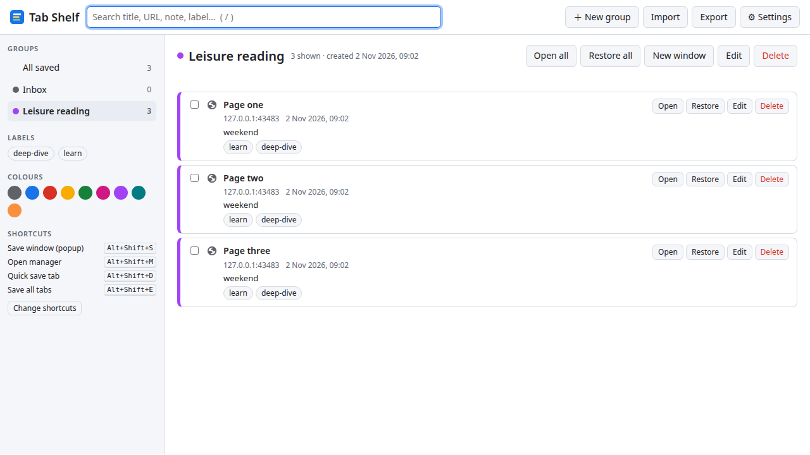
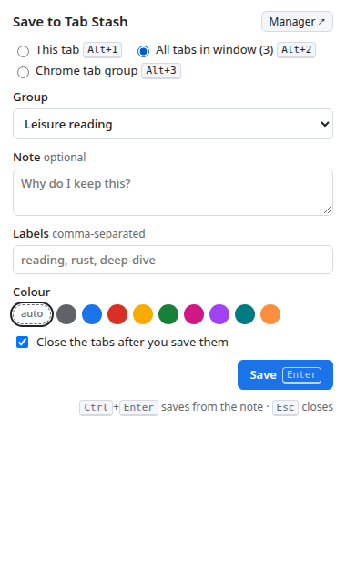

# Tab Stash

Tab Stash is an extension for Google Chrome. It saves open tabs into groups
that you make. Then it closes the tabs, and Chrome uses less memory. Later, you
can open the tabs again from the stash.

Each group and each saved tab has:

- a title
- a URL (saved tabs only)
- an optional note
- zero or more labels
- one colour

Example groups:

- "When I am free": tasks for a time when your usual work stops.
- "Leisure reading": articles that you want to read in detail later.



## Contents

1. [Install the extension](#install-the-extension)
2. [Save tabs](#save-tabs)
3. [Keyboard shortcuts](#keyboard-shortcuts)
4. [Open saved tabs again](#open-saved-tabs-again)
5. [Find saved tabs](#find-saved-tabs)
6. [Export and import](#export-and-import)
7. [Settings](#settings)
8. [Data and privacy](#data-and-privacy)
9. [Development](#development)
10. [Sync server](#sync-server)
11. [Other documents](#other-documents)
12. [License](#license)

## Install the extension

The extension is not in the Chrome Web Store. Load it as an unpacked extension.
You need Google Chrome 116 or later, or Chromium 116 or later. You do not need
Node.js to use the extension.

1. Get the files:

   ```sh
   git clone https://github.com/sadeq-n-yazdi/tab-stash.git
   ```

   If you do not have Git, download the ZIP file from the repository page (**Code** > **Download ZIP**). Then extract it.
2. Keep the files in this folder. Chrome loads the extension from this folder each time that it starts.
3. In Chrome, go to `chrome://extensions`.
4. Set **Developer mode** to on. The switch is at the top right.
5. Click **Load unpacked**.
6. Select the `extension` folder. This folder contains `manifest.json`.
7. Make sure that the ID on the **Tab Stash** card is `icppdneajfbmmpkgejjpjfegkppmneej`.
8. Click the puzzle icon in the toolbar, and pin **Tab Stash**.

When you install the extension, it makes one group with the name "Inbox".

The extension ID is the same on all computers, because `manifest.json` has a
fixed `key`. Chrome keeps your data under this ID.

For the full procedure, read [HOWTO.md](HOWTO.md). It also tells you how to:

- move your saved tabs to a different computer
- update the extension
- remove the extension
- find and repair problems

## Save tabs

### Save with the popup



1. Click the Tab Stash icon, or push `Alt+Shift+S`.
2. Select what to save:
   - **This tab** (`Alt+1`)
   - **All tabs in window** (`Alt+2`)
   - **Chrome tab group** (`Alt+3`). This choice shows only if the window has a Chrome tab group.
3. In **Group**, select a group.
4. To make a new group, select **＋ New group…**. Then type a name and select a colour for the group.
5. Optional: type a note.
6. Optional: type labels. Put a comma between two labels.
7. Optional: select a colour. If you select **auto**, the tab gets the colour of its group.
8. Push `Enter` to save. In the note field, push `Ctrl+Enter`.

If **Close the tabs after you save them** is on, the extension closes the tabs. It
closes them only after it saves them.

When you save a Chrome tab group, the extension fills in a new group with the
name and the colour of the Chrome tab group.

### Save with the right-click menu

1. Right-click on a page.
2. Select **Save tab and close to Tab Stash**.
3. Select a group. A star (★) shows the group that you used last.

To save a link and not open it, right-click on the link. Then select **Save
link to Tab Stash** and a group.

### What the extension does not save

- Blank pages and new tab pages.
- The pages of Tab Stash.
- Pinned tabs, when you save all tabs in a window. You can change this in
  [Settings](#settings).

If a URL is already in the group, the extension does not save it again.

If you close all tabs of a window, the extension opens a new tab first. Thus,
the window stays open.

## Keyboard shortcuts

| Shortcut      | Action                                                         |
| ------------- | -------------------------------------------------------------- |
| `Alt+Shift+S` | Open the popup. Select a group, note, labels and colour.       |
| `Alt+Shift+D` | Save the current tab to the group that you used last. Close the tab. |
| `Alt+Shift+E` | Save all tabs in the window to the group that you used last. Close the tabs. |
| `Alt+Shift+M` | Open the manager page.                                         |

After a save with a shortcut, the icon shows a green number for 30 seconds.
The number is the quantity of saved tabs. A red "!" shows an error. To read
the error, put the mouse pointer on the icon.

To change a shortcut:

1. Go to `chrome://extensions/shortcuts`. You can also click **Change shortcuts** on the manager page.
2. Find **Tab Stash**.
3. Click the pencil icon near the shortcut, and push the new keys.

NOTE: Chrome does not accept some keys, because Chrome uses them. For example,
Chromium 156 does not accept `Alt+Shift+W`, `Alt+Shift+A`, `Alt+Shift+C`,
`Alt+Shift+P`, `Alt+Shift+X` and `Alt+Shift+Z`. If Chrome does not accept a
key, the shortcut shows "not set" on the manager page.

## Open saved tabs again

Open the manager page. Push `Alt+Shift+M`, or click **Manager ↗** in the popup.

For one saved tab, click one of these buttons:

- **Open**: open the tab. The tab stays on the stash.
- **Restore**: open the tab and remove it from the stash.

For a group, select the group in the left column. Then click one of these
buttons:

- **Open all**: open all tabs of the group. The tabs stay on the stash.
- **Restore all**: open all tabs of the group and remove them from the stash.
- **New window**: open all tabs of the group in a new window.

The extension puts the tabs into a Chrome tab group. The Chrome tab group gets
the name and the colour of the saved group. You can stop this in
[Settings](#settings).

If a filter is active, **Open all** and **Restore all** open only the tabs that
you can see.

To work on many tabs at the same time:

1. Select the check boxes of the tabs.
2. Use the bar above the list: **Open**, **Restore**, **Move to…** or **Delete**.

Chrome does not let an extension open some types of URL, for example `file://`
URLs and some `chrome://` URLs. The manager shows "can fail to open" for these
URLs. If a tab does not open, the extension keeps it on the stash and shows the
URL in the status line.

## Find saved tabs

On the manager page:

- Type in the search box. Push `/` to go to the search box. Push `Esc` to clear it.
  The search looks at the title, URL, note and labels. It also looks at the
  name, note and labels of the group.
- Click a label in the left column. If you click more than one label, a tab
  must have all of them. A tab also has the labels of its group.
- Click a colour in the left column. If you click more than one colour, a tab
  can have any of them.
- Click a group in the left column. Click **All saved** to see all groups.

To change a tab or a group, click **Edit**. You can change the title, URL,
group, note, labels and colour.

## Export and import

Use export to make a backup, or to move your data to a different computer.

1. On the manager page, click **Export**.
2. Chrome downloads a file with the name `tab-stash-YYYY-MM-DD.json`.

To import:

1. On the manager page, click **Import**.
2. Select an export file.

The import adds the groups and tabs that you do not have. If a record is in
the file and also in Chrome, the import keeps the newer record. Thus, you can
import the same file two times, and you get no duplicates.

## Settings

Click **⚙ Settings** on the manager page.

| Setting | Default | Result |
| ------- | ------- | ------ |
| Close the tabs after you save them | On | The extension closes the tabs after a save. The popup has the same check box. |
| Do not save pinned tabs with "all tabs in window" | On | Pinned tabs stay open. |
| Open a saved group as a Chrome tab group | On | Opened tabs go into a Chrome tab group with the same name and colour. |
| Remove bookmarks after "Open all" | Off | If on, **Open all** is the same as **Restore all**. |

## Data and privacy

The extension keeps all data in Chrome on your computer
(`chrome.storage.local`). It sends no data to a server. It does not read the
content of pages. It reads only the title and the URL of the tabs that you
save.

The extension asks for these permissions:

| Permission | Why the extension needs it |
| ---------- | -------------------------- |
| `tabs` | To read the title and URL of the tabs that you save, and to close and open tabs. |
| `tabGroups` | To save a Chrome tab group, and to open a saved group as a Chrome tab group. |
| `storage`, `unlimitedStorage` | To keep your groups and saved tabs. The usual limit of 10 MB is too small for a large stash. |
| `contextMenus` | To show the right-click menus. |
| `alarms` | To remove the number from the icon after 30 seconds. |
| `favicon` | To show the site icons in the manager. The extension does not keep the icons. |

## Development

You need Node.js 20 or later. The extension has no build step. The files in
`extension/` are the extension.

```
extension/
  manifest.json       Manifest V3
  background.js       service worker: shortcuts, right-click menus, saves
  lib/model.js        data model, filters, merge, import checks (no chrome.* calls)
  lib/store.js        storage layer: one key for each record
  lib/actions.js      save, close and open tabs
  lib/ui.js           DOM helpers
  popup/              the popup
  manager/            the manager page
scripts/make-icons.mjs  makes the PNG icons
test/                   unit tests and the browser smoke test
docs/backend-api.md     API of the sync server
server/                 sync server in Go (refer to server/README.md)
```

To run the unit tests:

```sh
npm test
```

To run the smoke test in a real browser:

```sh
npm install
npx playwright install chromium
npm run test:smoke
```

The smoke test loads the extension into Chromium and does these steps:

1. It saves three pages and makes sure that the tabs close.
2. It examines the manager page.
3. It opens the tabs again as a Chrome tab group.
4. It examines the popup.

To keep screenshots, set `SCREENSHOTS=<folder>`.

NOTE: Google Chrome 137 and later ignore the `--load-extension` flag. The smoke
test uses the Chromium build of Playwright for this reason.

To make the icons again:

```sh
npm run icons
```

After you change the code, go to `chrome://extensions` and click the reload
icon on the Tab Stash card.

### Data model

Each group and each saved tab is one record. The extension keeps each record
under its own key: `g:<id>` for a group and `b:<id>` for a saved tab. Thus,
two pages can write at the same time and not delete the changes of the other
page.

Each record has these fields for sync:

- `id`: a UUID.
- `createdAt` and `updatedAt`: ISO 8601 times.
- `deletedAt`: the time of deletion, or `null`.

When you delete a record, the extension keeps it with a `deletedAt` time for
30 days. A sync server can then send the deletion to other computers. After 30
days, the extension removes the record.

## Sync server

The folder [server/](server/README.md) has a sync server in Go. It keeps the
stash on your own web server, with HTTPS and a user login. Then you can use
the same stash in other browsers and on other computers.

- The server has user accounts and admin accounts. An admin adds the user
  accounts, but cannot read the groups and the bookmarks of the users.
- The server is ready. The extension does not use it yet. Refer to
  [TODO.md](TODO.md).

To build and install the server, read [server/README.md](server/README.md).
The API is in [docs/backend-api.md](docs/backend-api.md).

## Other documents

| Document | Contents |
| -------- | -------- |
| [HOWTO.md](HOWTO.md) | Install, move, update and remove the extension. Troubleshooting. |
| [TODO.md](TODO.md) | Work that is not complete, and checks to do by hand. |
| [server/README.md](server/README.md) | Build, install and manage the sync server. |
| [docs/backend-api.md](docs/backend-api.md) | API of the sync server. |
| [LICENSE](LICENSE) | The MIT License. |

## License

Tab Stash is free software under the MIT License. Read [LICENSE](LICENSE).
